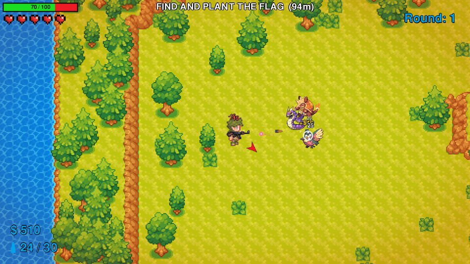
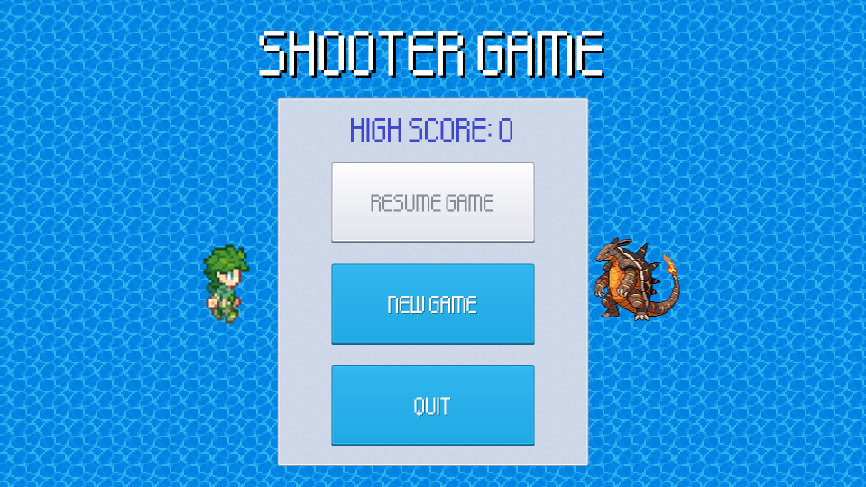
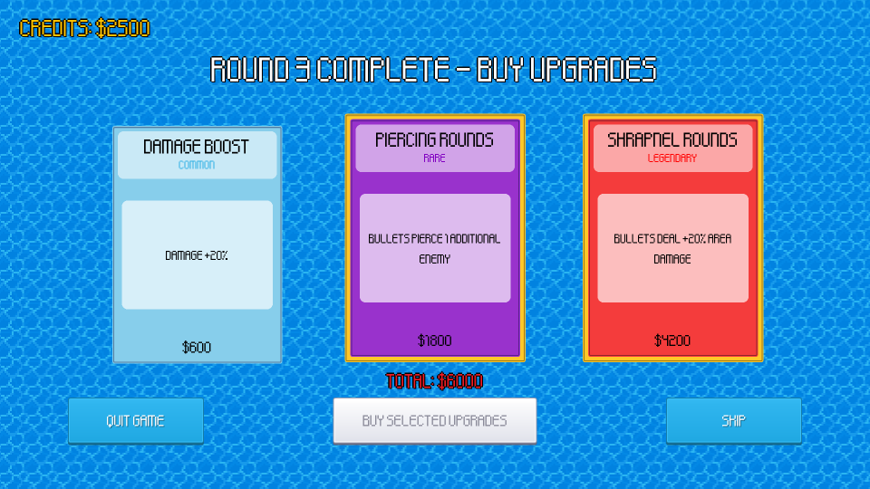
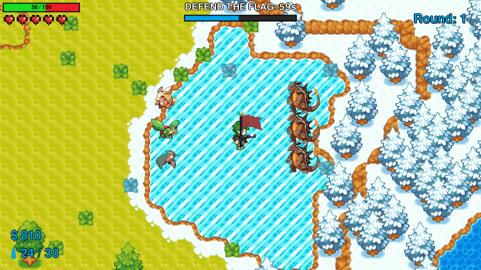

# Shooter Game

A top-down 2D pixel-art shooter made with Python and [pygame-ce](https://pyga.me/).
Fight your way across an island full of monsters, find the flag site, plant the flag and
defend it until the timer runs out. Between rounds, spend your money on upgrades.



## Features

- **Round-based objective:** each round you find a flag site, plant the flag, then
  defend it while every monster on the island comes for it.
- **Animated characters:** the player has a 4-direction walk cycle and always faces
  where you aim. Monsters have idle and attack animations and turn to face where they
  are going.
- **Three enemy types:**
  - **Melee** monsters chase you and hit you up close.
  - **Ranged** monsters keep their distance and fire glowing projectiles, in a colour
    that matches their element.
  - **Brutes** are big, slow and tough, and they hit hard. They show up from round 3
    and get more common as the rounds go on.
- **Game feel and effects:** muzzle flash and gun recoil, a spinning reload animation,
  hit flashes, floating damage numbers and money rewards, death bursts, bullet impact
  sparks, explosion rings for area damage, dust while walking, screen shake, and a red
  vignette when you are hurt or low on health.
- **Sound and music:** gunshots, reloads, footsteps, monster hits and deaths, coins, flag
  and round jingles, UI clicks, plus menu and battle music. Monster sounds get quieter
  the further away they are. Press `M` to mute.
- **Polished UI:** a pixel font, UI-pack buttons with hover and press states,
  rounded panels, and upgrade cards coloured by tier.
- **Island map:** a hand-built arena surrounded by a forest and an animated sea with a
  proper coastline, plus grass, desert, ruins and snow areas.
- **HUD:** a health bar that drains smoothly, lives, money, ammo and reload progress, the
  round number, a compass arrow pointing to the flag, and the current objective. Once
  the flag is planted, this becomes a defense timer.
- **Upgrade shop:** 22 upgrades in three tiers (common, rare and legendary) between rounds.
- **Save and resume:** use *Save and Quit* in the pause menu to continue the run later.
  Your high score is kept between runs.

| Main menu | Upgrade shop |
| --- | --- |
|  |  |



## Installation

Requires **Python 3.10+**.

```bash
git clone https://github.com/Yuyao24/2D-Shooter-Game.git
cd 2D-Shooter-Game
pip install -r requirements.txt
```

> The game uses **pygame-ce** (Community Edition), not the original `pygame` package,
> because it needs features like `FRect`. If you have `pygame` installed, uninstall it
> first (`pip uninstall pygame`), since both packages use the same `pygame` module name.

## Running the game

Run it from the project folder (asset paths are relative):

```bash
python main.py
```

The game opens in fullscreen at your monitor's resolution.

## Controls

| Action | Input |
| --- | --- |
| Move | `W` `A` `S` `D` |
| Aim | Mouse |
| Shoot | Left mouse button (hold it with the *Auto Clicker* upgrade) |
| Reload | `R` |
| Pause / resume | `Esc` |
| Mute / unmute sound | `M` |

## How to play

1. **Find the flag site.** The red arrow around your character points to it, and the
   top of the screen shows how far away it is.
2. **Plant the flag** by standing inside the red circle for 5 seconds. Leaving the
   circle resets your progress. Planting gives you **$300** and **500 points**.
3. **Defend the flag.** Once it is planted, every monster heads for it. The defense timer
   starts at **60 s** and counts down. Each hit the flag takes adds **2 s**.
   - The timer reaches 0: **round won** (+$800, +1000 points).
   - The timer reaches 120 s: **round lost**.
4. You also win a round by **killing every monster** on the map.
5. Your health **regenerates** after 3 seconds without taking damage.
6. **Dying** costs one life (you start with 5) and ends the round. Lose all your lives
   and it's game over.
7. Between rounds, **buy upgrades** with the money from kills and objectives. Each round,
   enemies get more health and deal more damage.

### Upgrades

| Tier | Upgrades |
| --- | --- |
| Common | Health Boost, Damage Boost, Fire Rate Boost, Speed Boost, Quick-Silver, Toughness, Quick Reload, Long Shot, Magazine Boost |
| Rare | Gold Gold Gold, Return Policy, Tank, Berserker, Piercing Rounds, Vampiric Touch, Insta-Reload |
| Legendary | Lucky Shot, Shrapnel Rounds, Extra Life, Holy Trinity, Adrenaline, Auto Clicker |

## Project structure

```
main.py            Entry point: window setup and game state machine
gameplay.py        Gameplay loop, round management, spawning, map loading
player.py          Player (movement, animation), Gun and Bullet
enemy.py           Monster loading and animation; Melee, Ranged and Brute enemies; enemy projectiles
flag.py            Flag site, planting, defense timer and waving flag animation
sound.py           Sound effects and music (Audio)
effects.py         Particles, floating text, muzzle flash, rings and screen shake (FX)
map.py             Ground layer (animated tiles), map sprites, collision spatial hash, A* pathfinding
menus.py           Buttons, text, HUD, menu background, main/pause/game-over menus
upgrades.py        Upgrade definitions and the upgrade shop
settings.py        Constants, asset cache, camera, save/load helpers
stats_manager.py   Score and run statistics
tools/simulate.py  Headless bot that plays games for testing and balancing
assets/            Images, sprite sheets, UI images, fonts, audio and the Tiled map
game_save/         Save file and high score
```

## Simulating games (testing and balancing)

`tools/simulate.py` plays full games headlessly with a simple bot. The bot walks to the flag,
plants and defends it, shoots and dodges, and buys upgrades. Game time is simulated, so a
whole game takes seconds. The script prints statistics as JSON: how each round ended,
damage taken per enemy type, money, stuck enemies and real enemy speed.

```bash
python tools/simulate.py --games 5 --max-rounds 15 --seed 1
```

Use it after changing numbers like enemy damage or rewards, to see how the difficulty curve shifts.

## Editing the map

The map is a [Tiled](https://www.mapeditor.org/) map: `assets/map/world.tmx`. These are the layers the game reads:

| Layer | Purpose |
| --- | --- |
| `Ground` | Tiles (uses `world_tileset.tsx`, `Objects.tsx` and the animated `coast.tsx`) |
| `Rocks` | Small obstacles with collision |
| `Objects` | Trees and pillars with collision |
| `Decor` | Decorative objects without collision (grass, forest outside the arena) |
| `Collisions` | Invisible collision rectangles (the arena walls) |
| `Entities` | Spawn points named `Player`, `Enemy` and `Flag` |

Tile animations defined in Tiled (like the sea in `coast.tsx`) play in-game automatically.

## Credits

### External game assets

| Asset | Creator | Source | License |
| --- | --- | --- | --- |
| Player sprite sheet, monster sprites, map tilesets (world, coast/water) and map objects | scarloxy | [itch.io](https://scarloxy.itch.io/mpwsp01) | [CC BY 4.0](https://creativecommons.org/licenses/by/4.0/) |
| Gun and bullet images | greenpixels_ | [itch.io](https://greenpixels.itch.io/pixel-art-assets-7) | [CC BY 4.0](https://creativecommons.org/licenses/by/4.0/) |
| Crosshair image | Kenney | [kenney.nl](https://kenney.nl/assets/crosshair-pack) | [CC0 1.0](https://creativecommons.org/publicdomain/zero/1.0/) |
| Heart image | Shlok Gupta | [itch.io](https://gamedevshlok.itch.io/heartpack) | Free |
| Flag image | ankousse26 | [itch.io](https://ankousse26.itch.io/free-flag-with-animation) | Free |
| UI buttons and panels (UI Pack) | Kenney | [OpenGameArt](https://opengameart.org/content/ui-pack) | [CC0 1.0](https://creativecommons.org/publicdomain/zero/1.0/) |
| Pixel font (`kenpixel_high`) | Kenney | [OpenGameArt](https://opengameart.org/content/kenney-fonts) | [CC0 1.0](https://creativecommons.org/publicdomain/zero/1.0/) |

### Audio

| Sound | Creator | Source | License |
| --- | --- | --- | --- |
| Gunshot, hit, slam and explosion sounds (100 CC0 SFX) | rubberduck | [OpenGameArt](https://opengameart.org/content/100-cc0-sfx) | [CC0 1.0](https://creativecommons.org/publicdomain/zero/1.0/) |
| Reload, footstep and coin sounds (50 RPG sound effects) | Kenney | [OpenGameArt](https://opengameart.org/content/50-rpg-sound-effects) | [CC0 1.0](https://creativecommons.org/publicdomain/zero/1.0/) |
| Monster projectile and death sounds (Sci-fi sounds) | Kenney | [OpenGameArt](https://opengameart.org/content/sci-fi-sounds) | [CC0 1.0](https://creativecommons.org/publicdomain/zero/1.0/) |
| Flag, round and alert jingles (Interface sounds) | Kenney | [OpenGameArt](https://opengameart.org/content/interface-sounds) | [CC0 1.0](https://creativecommons.org/publicdomain/zero/1.0/) |
| Button click and hover sounds (UI Pack) | Kenney | [OpenGameArt](https://opengameart.org/content/ui-pack) | [CC0 1.0](https://creativecommons.org/publicdomain/zero/1.0/) |
| Menu music ("Town Theme RPG") | cynicmusic | [OpenGameArt](https://opengameart.org/content/town-theme-rpg) | [CC0 1.0](https://creativecommons.org/publicdomain/zero/1.0/) |
| Battle music ("Battle Theme A") | cynicmusic | [OpenGameArt](https://opengameart.org/content/battle-theme-a) | [CC0 1.0](https://creativecommons.org/publicdomain/zero/1.0/) |

### Inspiration

| Game | Developer | Link |
| --- | --- | --- |
| SYNTHETIK: Legion Rising | Flow Fire Games | [Steam](https://store.steampowered.com/app/528230/SYNTHETIK_Legion_Rising/) |
| CS2D | Unreal Software | [Steam](https://store.steampowered.com/app/666220/CS2D/) |
